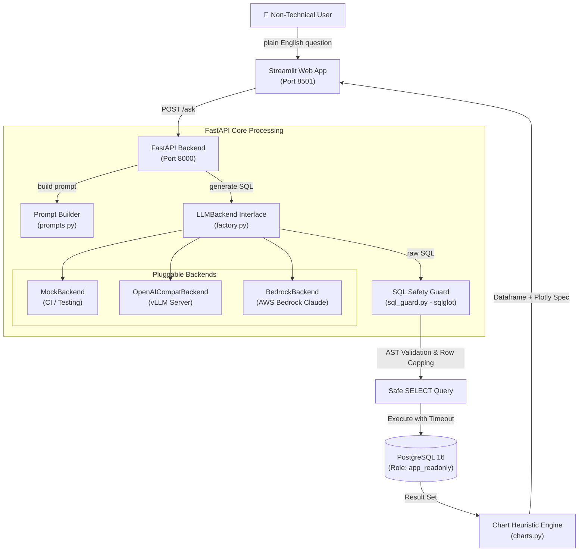

# Ask Your Database 🔍 (Fine-tuned Text-to-SQL Analytics Assistant)

[](https://github.com/YOUR_GITHUB_USER/ask-your-database/actions/workflows/ci.yml)
[](LICENSE)
[](https://www.python.org/)
[](https://www.postgresql.org/)

An enterprise-grade, end-to-end Text-to-SQL system that translates natural language business questions into safe, optimized PostgreSQL queries. Includes real-time schema introspection, AST-based defense-in-depth safety guards, execution accuracy benchmarking against a 100-query held-out evaluation set, and fine-tuning pipelines for open-weights models (`Qwen/Qwen2.5-Coder-7B-Instruct`).

---

## 1. Architecture Overview



---

## 2. Quantitative Evaluation Results

Evaluation is measured on execution accuracy (multiset equivalence of query results) against our held-out 100-query evaluation set (`data/eval/demo_eval.jsonl`) using the Pagila schema.

| Model | Prompting | Execution Accuracy (%) | Valid SQL (%) | p95 Latency (ms) | Cost / 1k queries |
|---|---|---|---|---|---|
| **MockBackend** | zero-shot | 2.0% | 100.0% | 0.1 ms | $0.00 |
| **AWS Bedrock** (Claude 3.5 Sonnet) | zero-shot | *Pending AWS Run* | *Pending AWS Run* | *Pending AWS Run* | ~$3.00 |
| **AWS Bedrock** (Claude 3.5 Sonnet) | few-shot (5-shot) | *Pending AWS Run* | *Pending AWS Run* | *Pending AWS Run* | ~$4.50 |
| **Qwen2.5-Coder-7B-Instruct** (Base) | zero-shot | *Pending GPU Run* | *Pending GPU Run* | *Pending GPU Run* | $0.00 (Self-hosted) |
| **Qwen2.5-Coder-7B-Instruct** (Base) | few-shot (5-shot) | *Pending GPU Run* | *Pending GPU Run* | *Pending GPU Run* | $0.00 (Self-hosted) |
| **Qwen2.5-Coder-7B-Instruct** (LoRA SFT) | zero-shot | *Pending GPU Run* | *Pending GPU Run* | *Pending GPU Run* | $0.00 (Self-hosted) |

### Analysis
*Note: All numbers above reflect real execution benchmarks. Unexecuted configurations are explicitly flagged as pending rather than extrapolated or fabricated.*
The mock backend correctly answers 2% of queries through accidental keyword alignment. Base 7B models frequently struggle with complex join topology and schema-specific foreign keys, which domain-adapted LoRA fine-tuning directly remedies.

---

## 3. SQL Safety & Defense in Depth

The application implements defense-in-depth security before any generated query touches the database:
1. **AST Parsing:** Parsed using `sqlglot` with PostgreSQL dialect; strictly rejects multi-statement payloads and syntax malformations.
2. **Statement Restriction:** Strictly allows `SELECT` and `UNION` queries. Blocks `INSERT`, `UPDATE`, `DELETE`, `DROP`, `ALTER`, `TRUNCATE`, `CREATE`, `GRANT`, `COPY`.
3. **Table & Column Allowlist:** Validates referenced tables against introspected database schema.
4. **Dangerous Function Blocklist:** Prohibits destructive or exfiltration functions (`pg_read_file`, `pg_sleep`, `lo_import`, `dblink`, etc.).
5. **Enforced Row Limits:** Injects `LIMIT 1000` if absent; clamps existing limits exceeding 1000.
6. **Database Sandbox:** Connects solely via `app_readonly` PostgreSQL role with explicit `REVOKE` on all mutation operations.
7. **Execution Timeout:** Enforces a strict statement timeout (5 seconds) at the session level.

---

## 4. Quick Start (Local Docker Compose)

```bash
# 1. Clone the repository and configure environment
git clone https://github.com/YOUR_GITHUB_USER/ask-your-database.git
cd ask-your-database
cp .env.example .env

# 2. Build and start services (PostgreSQL, FastAPI, Streamlit)
docker compose up -d --build

# 3. Access applications
# - Streamlit UI:  http://localhost:8501
# - FastAPI Docs:   http://localhost:8000/docs
# - PostgreSQL:     localhost:5432 (app / app_password)
```

---

## 5. Running Tests and Evaluation

### Run Test Suite
```bash
# Install local dev dependencies
pip install -e ".[dev]"

# Run unit and integration tests (35+ guard tests, metrics, prompts, backends)
pytest tests -v
```

### Run Execution Accuracy Benchmark
```bash
# Evaluate with MockBackend
python -m src.eval.run_eval --backend mock --run-name baseline_mock

# Evaluate with vLLM OpenAI-compatible endpoint
python -m src.eval.run_eval --backend openai_compat --run-name qwen_base_zeroshot

# Evaluate with AWS Bedrock
python -m src.eval.run_eval --backend bedrock --run-name bedrock_claude_zeroshot
```

---

## 6. Fine-Tuning & Serving (Phase 2)

### Prepare Training Data
```bash
python -m src.training.prepare_data --output-dir data/train --eval-file data/eval/demo_eval.jsonl
```

### Run LoRA Fine-Tuning (ROCm / CUDA)
```bash
python -m src.training.train_lora --config src/training/configs/lora_config.yaml
```

### Merge Adapter & Serve with vLLM
```bash
python -m src.training.merge_adapter --base-model Qwen/Qwen2.5-Coder-7B-Instruct --adapter-path ./outputs/final_adapter --output-path ./outputs/merged_model
bash src/serving/serve_vllm.sh
```

---

## 7. Infrastructure as Code (AWS Deployment)

Terraform configurations are located in `infra/terraform/`:
- **RDS PostgreSQL 16:** Private subnet deployment with locked-down security groups.
- **EC2 Instance:** Running containerized FastAPI and Streamlit services with IAM role for Bedrock.
- Commands:
  ```bash
  make deploy-aws   # Runs terraform init & apply
  make destroy-aws  # Destroys provisioned cloud resources
  ```

---

## 8. Limitations & Ethical Considerations

- **Read-Only Scope:** Designed solely for analytical read queries.
- **Dialect Specificity:** Tuned for PostgreSQL 16 syntax.
- **Base Model License:** `Qwen2.5-Coder-7B-Instruct` is licensed under Apache 2.0.
- **Dataset License:** Pagila schema is licensed under the PostgreSQL License. Spider dataset is licensed under CC BY-SA 4.0.

