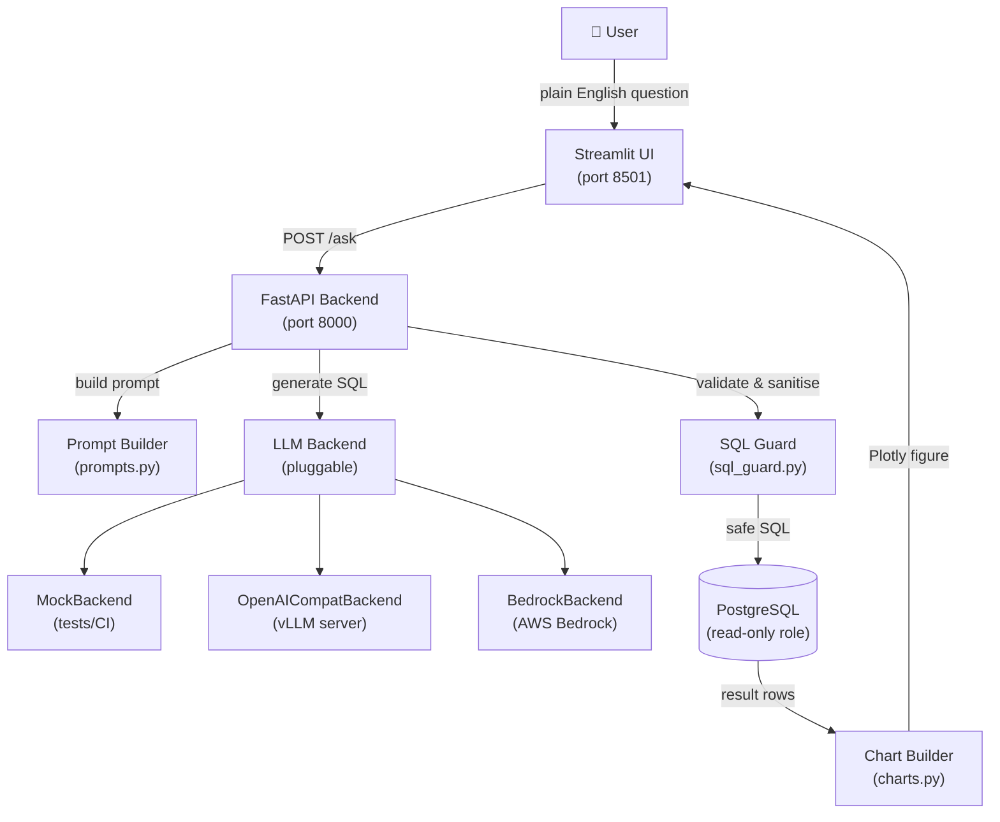

# Architecture

## System Overview



---

## Components

### FastAPI Backend (`src/app/`)

| File | Responsibility |
|---|---|
| `main.py` | HTTP endpoints, request orchestration |
| `prompts.py` | Single source of truth for prompt format (identical in training and inference) |
| `sql_guard.py` | Multi-layer SQL safety (sqlglot parsing, allowlist, limit injection) |
| `schema.py` | Live schema introspection from PostgreSQL, cached |
| `charts.py` | Heuristic chart type selection, Plotly figure generation |
| `database.py` | Read-only DB connections, statement timeout |

### LLM Backends (`src/app/llm/`)

| Backend | Use case |
|---|---|
| `MockBackend` | Unit tests, CI — no model needed |
| `OpenAICompatBackend` | vLLM server (fine-tuned model, local or remote) |
| `BedrockBackend` | AWS Bedrock (Claude 3.5 Sonnet) |

### SQL Guard Layers

1. **sqlglot parse** — rejects malformed SQL
2. **Statement type** — SELECT only
3. **Table allowlist** — known schema tables only
4. **Dangerous function blocklist**
5. **LIMIT injection/cap** (max 1000 rows)
6. **Statement timeout** (5 s, applied at DB level)
7. **Read-only role** (DB-level enforcement)
8. **Logging** of every query

### Evaluator (`src/eval/`)

- `run_eval.py` — Execution-accuracy evaluator; works with any `LLMBackend`
- `metrics.py` — Result set comparison (multiset, normalised)

### Training (`src/training/`)

- `prepare_data.py` — Spider + synthetic data, leakage guard
- `train_lora.py` — LoRA SFT with TRL; loss on completion only
- `merge_adapter.py` — Merge LoRA adapter into base model

---

## Security

| Layer | Mechanism |
|---|---|
| DB credentials | Environment variables only — never hard-coded |
| DB permissions | App connects as `app_readonly` (SELECT only) |
| SQL validation | Guard rejects all DDL/DML before execution |
| Network | RDS not publicly accessible (private subnet on AWS) |
| Query cost | Statement timeout (5 s) prevents runaway queries |

---

## Deployment

### Local

```bash
cp .env.example .env
docker compose up
```

| Service | Port |
|---|---|
| PostgreSQL | 5432 |
| FastAPI backend | 8000 |
| Streamlit UI | 8501 |

### AWS (Terraform)

```bash
make deploy-aws   # terraform init + apply
make destroy-aws  # terraform destroy
```

- RDS in private subnet (no internet route)
- EC2 instance with IAM role for Bedrock access
- LLM via AWS Bedrock (no GPU required in cloud deployment)

### Makefile targets

| Target | Description |
|---|---|
| `make up` | Start local stack via docker compose |
| `make down` | Stop local stack |
| `make eval` | Run evaluator against local stack |
| `make test` | Run pytest suite |
| `make lint` | Run ruff |
| `make deploy-aws` | Terraform apply |
| `make destroy-aws` | Terraform destroy |
